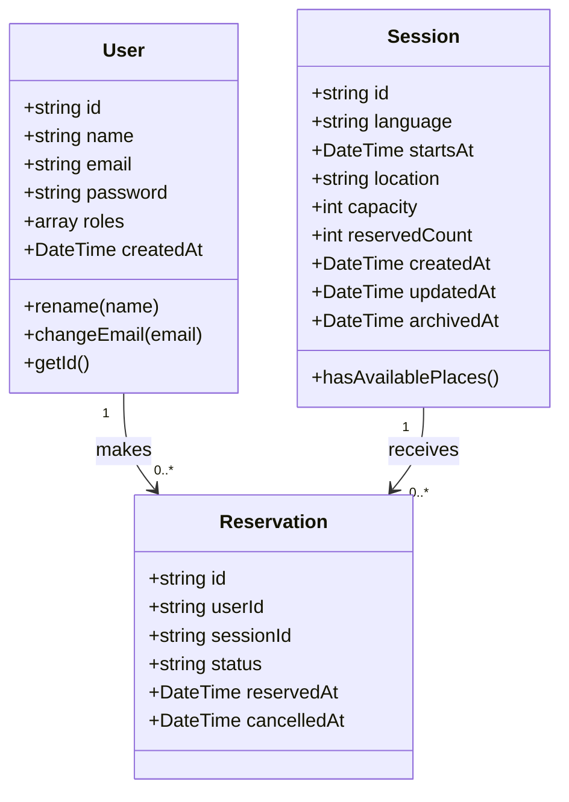

# ETS Language Booking Platform

Une application web full-stack pour la gestion des sessions d'évaluation linguistique et la réservation de places. La plateforme permet aux utilisateurs de parcourir les sessions disponibles, d'effectuer et gérer leurs réservations, et de mettre à jour leurs informations de profil. Les administrateurs peuvent quant à eux gérer les sessions et leur capacité.

## 🚀 Fonctionnalités

### 🔐 Authentification & Gestion des utilisateurs

* Inscription et connexion des utilisateurs.

* Authentification basée sur **JWT** via des cookies HTTP-only sécurisés.

* Pages et routes API protégées.

* Contrôle d'accès basé sur les rôles (`ROLE_USER`, `ROLE_ADMIN`).

* Gestion du profil utilisateur.

### 📅 Sessions de langue

* Consultation des sessions d'évaluation linguistique disponibles.

* Liste paginée des sessions.

* Détails de la session : langue, date, emplacement et capacité.

* Gestion administrative des sessions.

* Suivi en temps réel des places disponibles et du nombre de réservations.

### 🎟️ Réservations

* Réservation de place dans une session.

* Annulation d'une réservation existante.

* Prévention des réservations multiples actives pour le même utilisateur et la même session.

* Réactivation d'une réservation préalablement annulée.

* Respect strict de la capacité maximale des sessions.

* Protection contre les requêtes concourantes (concurrence) grâce aux transactions MongoDB et aux mises à jour atomiques.

### 🧪 Tests

* **Backend :** Tests automatisés avec PHPUnit.

* **Frontend :** Tests de composants avec Jest et React Testing Library.

* Tests spécifiques de concurrence sur les réservations.

## 🛠️ Architecture

L'application repose sur trois services principaux :

| Composant | Technologie | Description | 
| ----- | ----- | ----- | 
| **Frontend** | Next.js, React, TypeScript | Interface utilisateur | 
| **Backend** | Symfony, PHP 8.4+ | API REST et logique métier | 
| **Database** | MongoDB 7 | Persistence des données | 

### Aperçu de l'architecture

```
                 Web Browser
                      |
                      | HTTP
                      v
               Next.js Frontend
                  Port 3000
                      |
                      | REST API
                      | JWT Cookie
                      v
               Symfony Backend
                  Port 8000
                      |
                      | MongoDB ODM
                      v
                  MongoDB 7
                  Port 27017
              Replica Set (rs0)

```

### 🖥️ Backend

Développé avec **Symfony**, il met à disposition l'API REST.

* **Responsabilités :** Authentification, autorisation, gestion des comptes, logique métier des réservations, validation des données, gestion des erreurs API, persistance avec Doctrine MongoDB ODM et gestion des transactions.

### 🎨 Frontend

Développé avec **Next.js**, **React** et **TypeScript**.

* **Responsabilités :** Interfaces d'authentification, pages protégées, navigation/pagination des sessions, gestion des réservations, gestion du profil et communication avec l'API REST backend.

### 🗄️ Base de données

**MongoDB 7** est utilisé comme base de données principale.

* Exécution sous forme de Replica Set à nœud unique (`rs0`) pour prendre en charge les transactions.

* Cohérence garantie par : des contraintes d'unicité (utilisateur/session), des mises à jour atomiques de capacité et des transactions MongoDB.

---

## 📊 Diagramme de Classes



---

## 🔒 Sécurité et Fiabilité

* Authentification JWT stockée dans des cookies HTTP-only.

* Autorisations strictes basées sur les rôles.

* Endpoints backend sécurisés.

* Configuration CORS stricte pour les échanges Frontend/Backend.

* Validation rigoureuse côté serveur.

* Contraintes d'unicité et mises à jour atomiques en base de données.

* Transactions MongoDB pour sécuriser les réservations simultanées.

## 📋 Prérequis

Pour exécuter le projet, vous devez installer :

* **Docker**

* **Docker Compose v2** (ou plus récent)

* **Git**

> 💡 *Aucune installation locale de PHP, Composer, Node.js ou MongoDB n'est requise lors de l'utilisation du setup Docker Compose.*

## 📁 Structure du Projet

```
ets-language-booking/
│
├── backend/
│   ├── config/
│   ├── public/
│   ├── src/
│   │   ├── Controller/
│   │   ├── Document/
│   │   ├── Repository/
│   │   ├── Service/
│   │   └── ...
│   ├── tests/
│   │   ├── Unit/
│   │   └── Integration/
│   ├── composer.json
│   └── Dockerfile
│
├── frontend/
│   ├── src/
│   │   ├── app/
│   │   ├── components/
│   │   ├── features/
│   │   ├── lib/
│   │   └── types/
│   ├── tests/
│   ├── jest.config.js
│   ├── jest.setup.ts
│   ├── package.json
│   └── Dockerfile
│
├── docker-compose.yml
└── README.md

```

## 🚀 Démarrage rapide avec Docker Compose

### 1. Cloner le dépôt

```
git clone <REPOSITORY_URL>
cd ets-language-booking

```

### 2. Configurer les variables d'environnement

Éditez le fichier `.env` selon vos besoins :

#### ⚙️ Backend

| Variable | Description | Configuration recommandée | 
| ----- | ----- | ----- | 
| `APP_ENV` | Environnement Symfony (`dev`, `test`, `prod`) | Conserver `dev` en développement. | 
| `APP_SECRET` | Clé secrète pour les opérations cryptographiques | Générer une valeur unique via `openssl rand -hex 32`. | 
| `BACKEND_PORT` | Port d'accès à l'API Backend sur l'hôte | Par défaut : `8000`. | 


#### 🗄️ MongoDB

| Variable | Description | Configuration recommandée | 
| ----- | ----- | ----- | 
| `MONGODB_DB` | Nom de la base de données MongoDB | Par défaut : `ets_booking`. | 

> *Note : MongoDB s'exécute dans Docker. Le backend s'y connecte via le nom d'hôte interne `mongodb`.*

#### 🔑 Authentification JWT

| Variable | Description | Configuration recommandée | 
| ----- | ----- | ----- | 
| `JWT_SECRET_KEY` | Chemin vers la clé privée JWT | Conserver `/app/config/jwt/private.pem`. | 
| `JWT_PUBLIC_KEY` | Chemin vers la clé publique JWT | Conserver `/app/config/jwt/public.pem`. | 
| `JWT_PASSPHRASE` | Passphrase protégeant la clé privée JWT | Choisir une passphrase forte et personnelle. | 
| `JWT_TTL` | Durée de validité du token JWT (en secondes) | Par défaut : `900` (15 minutes). | 

Les clés JWT sont générées automatiquement lors du premier démarrage du backend dans `backend/config/jwt/`.

Si vous modifiez la valeur de `JWT_PASSPHRASE` par la suite, régénérez la paire de clés :

```
docker compose exec backend php bin/console lexik:jwt:generate-keypair --overwrite

```

*(Attention : Régénérer les clés invalidera les tokens JWT précédemment émis).*

#### 🍪 Configuration des Cookies

| Variable | Description | Configuration recommandée | 
| ----- | ----- | ----- | 
| `COOKIE_SECURE` | Envoi des cookies uniquement via HTTPS | Utiliser `false` en local (HTTP) et `true` en production (HTTPS). | 

#### 🌐 Configuration CORS

```
CORS_ALLOW_ORIGIN=^https?://(localhost|127\.0\.0\.1|SERVER_IP)(:[0-9]+)?$

```

Remplacez `SERVER_IP` par l'adresse IP de la machine hébergeant l'application.
*Exemple si l'IP du serveur est `192.168.1.50` :*

```
CORS_ALLOW_ORIGIN=^https?://(localhost|127\.0\.0\.1|192\.168\.1\.50)(:[0-9]+)?$

```

#### 💻 Configuration Frontend

| Variable | Description | Configuration recommandée | 
| ----- | ----- | ----- | 
| `NEXT_PUBLIC_API_URL` | URL de l'API Backend accessible par le navigateur | Remplacer `SERVER_IP` par l'IP ou le nom d'hôte du backend. | 
| `FRONTEND_PORT` | Port d'accès au Frontend Next.js sur l'hôte | Par défaut : `3000`. | 

*Exemple :*

```
NEXT_PUBLIC_API_URL=http://192.168.1.50:8000/api
FRONTEND_PORT=3000

```

> ⚠️ **Important :** `NEXT_PUBLIC_API_URL` doit être accessible directement depuis le navigateur de l'utilisateur. Ne pas utiliser `http://backend:8000/api` (nom d'hôte Docker interne non résolu par le navigateur).

Pour un environnement de développement local standard sur la même machine :

```
CORS_ALLOW_ORIGIN=^https?://(localhost|127\.0\.0\.1)(:[0-9]+)?$
NEXT_PUBLIC_API_URL=http://localhost:8000/api

```

### 3. Lancer l'application

Construire et démarrer tous les services en arrière-plan :

```
docker compose up -d --build

```

### 4. Création d'un compte Administrateur

Pour pouvoir ajouter et gérer les sessions de test, vous devez créer un compte administrateur via la commande suivante :

```bash
docker compose exec backend php bin/console app:user:create-admin
```

Saisissez ensuite les informations demandées dans la console :
* **Admin email:** `admin.user@example.com`
* **Admin name:** `admin_username`
* **Password:** `admin_password`

Une fois connecté avec ce compte administrateur, accédez au panneau de gestion et utilisez le formulaire **"Create a test session"** (`#create-session-heading`) pour créer vos sessions. Les champs à renseigner sont :
* **Language** (`new-session-language`) : Langue de l'évaluation (max. 80 caractères).
* **Date and time** (`new-session-starts-at`) : Date et heure de début (interprétées selon votre fuseau horaire local).
* **Location** (`new-session-location`) : Lieu de la session (max. 240 caractères).
* **Capacity** (`new-session-capacity`) : Capacité de la session (nombre entre 1 et 10 000).

---


## 🧪 Lancement des Tests

### 🖥️ Tests Backend

Exécuter la suite complète de tests PHPUnit :

```
docker compose exec backend php bin/phpunit

```

Exécuter un fichier de test spécifique (ex: tests de concurrence) :

```
docker compose exec backend php bin/phpunit tests/Integration/ReservationConcurrencyTest.php

```

**Scénarios couverts par les tests de concurrence :**

1. Deux requêtes simultanées tentent de réserver la dernière place disponible : une seule doit réussir.

2. Un utilisateur annule sa réservation : la place doit redevenir disponible immédiatement.

3. Les réservations en double et les réservations sur des sessions complètes doivent être rejetées.

### 🎨 Tests Frontend

Exécuter la suite de tests Jest :

```
docker compose exec frontend npm test -- --runInBand

```

**Éléments couverts par les tests Frontend :**

* Mise à jour du profil utilisateur.

* Liste des sessions et pagination.

* Soumission de réservations.

* Formulaires d'authentification.

* Protection des pages.

## 📄 Licence

Ce projet est propriétaire. Tous droits réservés.